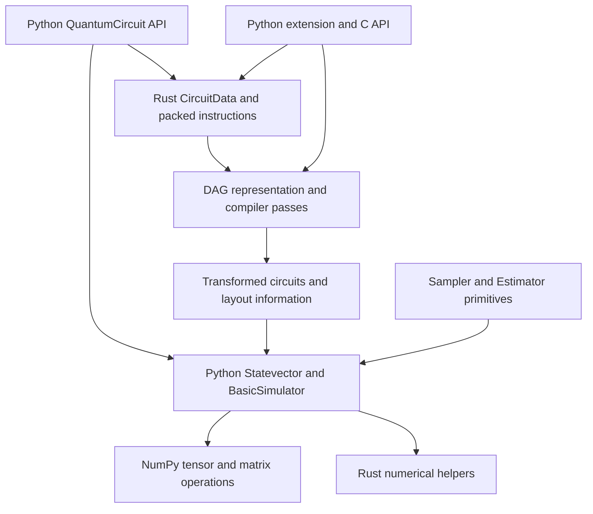

# Qiskit source review and recommendations for the Rust simulator

Review date: November 8, 2026  
Repository: <https://github.com/Qiskit/qiskit>  
Reviewed revision: [`9ab2106352f603bf411e1387a758f6d9667c7c1c`](https://github.com/Qiskit/qiskit/tree/9ab2106352f603bf411e1387a758f6d9667c7c1c)  
Workspace version at that revision: `2.7.0-dev`.

## 1. Scope and confidence

This is a source-based architecture review with detailed inspection of the paths most relevant to our proposed state-vector simulator. The checkout contains 4,199 tracked files, including 336 Rust and 1,159 Python source files. I indexed the repository, mapped its subsystems, and read selected implementations and tests. **This is not an exhaustive line-by-line audit of every file.**

The deepest inspection covers circuit storage, state-vector evolution, measurement and sampling, estimator execution, Pauli expectation kernels, and selected compiler optimizations. Parsing, serialization, synthesis, C bindings, visualization, and packaging are mapped at a higher level. Qiskit Aer internals were not reviewed in this pass.

No Qiskit build, runtime test suite, or performance benchmark was run. Findings below distinguish directly observed code behavior from proposed changes and unmeasured performance hypotheses. Source links are pinned to the reviewed commit so that later changes to `main` do not change the evidence.

This report complements the three existing project design documents; it does not change their scope or claim that our simulator has already been implemented.

## 2. What Qiskit actually does

Qiskit combines circuit construction, compiler infrastructure, quantum-information tools, execution interfaces, and reference simulation paths. It already uses Rust extensively. Rewriting Python into Rust alone would not establish a competitive advantage.

The key distinction for this project is between:

| Component | Role | Value to our project |
|---|---|---|
| `QuantumCircuit` and Rust circuit structures | Represent instructions, parameters, bits, control flow, and metadata | Learn compact representation and precise semantics |
| Transpiler and synthesis | Rewrite circuits for a target's gates and hardware constraints | Learn optimization boundaries; avoid implementing the full compiler initially |
| Python `Statevector` | General state and subsystem operations using NumPy, plus native numerical helpers | Small-system correctness reference and opportunities to specialize |
| `BasicSimulator` | Basic backend implementation with tensor-based state evolution and a Clifford fast path | Learn backend behavior, measurement mapping, and shot handling |
| `StatevectorSampler` / `StatevectorEstimator` | Adapt state simulation into primitive inputs and results | Learn batching, broadcasting, output contracts, and stochastic behavior |
| Qiskit Aer, a separate repository | Optimized simulation implementation | Required performance baseline and next kernel-level source review |

The [repository README][readme] describes the SDK and its Python/C interfaces. The [Rust workspace manifest][cargo] shows the native crate structure. The simulator paths discussed here must not be presented as Aer implementation details.

## 3. Repository architecture

### 3.1 Main layers



These are conceptual layers, not a claim that all calls pass through every box. A circuit can be simulated without hardware transpilation. The C interface and Python extension expose overlapping native infrastructure through different boundaries.

### 3.2 Subsystem map

| Area | Representative locations | Implementation purpose |
|---|---|---|
| Public circuit API | `qiskit/circuit/` | Circuit building, gate objects, parameters, classical expressions, control flow |
| Native circuit model | `crates/circuit/` | Packed instruction sequences, bit registries, parameter tracking, DAG representation |
| Circuit constructors | `qiskit/circuit/library/`, `crates/circuit_library/` | Reusable circuits and gate families |
| Compilation | `qiskit/compiler/`, `qiskit/transpiler/`, `crates/transpiler/` | Target-driven rewriting, layout, routing, optimization, scheduling |
| Pass orchestration | `qiskit/passmanager/`, `crates/passmanager/` | Execution of compiler tasks and pipelines |
| Synthesis | `qiskit/synthesis/`, `crates/synthesis/` | Convert structured operators or unitaries into gate sequences |
| Quantum information | `qiskit/quantum_info/`, `crates/quantum_info/` | States, operators, Paulis, stabilizers, sparse observables, numerical operations |
| Small native accelerators | `crates/accelerate/` | Focused kernels such as Pauli expectation calculations |
| Execution contracts | `qiskit/providers/`, `qiskit/primitives/`, `crates/providers/` | Backends, jobs, primitive inputs/results, quantum programs |
| Interchange | `qiskit/qasm2/`, `qiskit/qasm3/`, `qiskit/qpy/` and corresponding crates | Parsing, export, and persistence |
| Language interfaces | `crates/pyext/`, `crates/cext/`, `crates/cext-vtable/`, bindgen crates | Python extension, C ABI, generated interfaces |
| Other infrastructure | `crates/mir/`, `crates/util/` | Additional IR machinery and shared utilities |
| Results and presentation | `qiskit/result/`, `qiskit/visualization/` | Output processing and visualization |
| Verification | `test/python/`, `test/c/`, Rust tests, `test/benchmarks/` | Behavioral coverage, ABI-facing tests, performance regression tracking |

The [crate overview][crates] explains the single-extension architecture: `qiskit-pyext` builds the Python extension, while other crates contribute native functionality. Keeping shared Rust types within one extension avoids difficult interactions between independently loaded Rust extension libraries.

Some explanatory crate documentation lags the implementation: the circuit README discusses a possible future Rust DAG backing, but the reviewed source already defines `DAGCircuit` in Rust. Source and manifests take precedence over historical prose.

### 3.3 Dependency and packaging lessons

The workspace centralizes dependencies such as `num-complex`, `ndarray`, Rayon, PyO3, `nalgebra`, and `faer`. Release builds enable fat LTO and one codegen unit. Those settings are evidence of build choices, not proof that the same settings will be optimal for us. See [Cargo configuration][cargo].

The [circuit crate manifest][circuit-manifest] includes PyO3 and NumPy dependencies; the [quantum-info crate][qi-manifest] has an optional Python feature. Therefore, “written in Rust” does not by itself mean a crate can be adopted as an independent, Python-free simulator dependency. Reuse needs dependency and API review.

**Recommendation:** keep our state storage and kernel crates independent of Python, CUDA, and vendor BLAS by default. Introduce bindings and device adapters at the edges.

## 4. How circuits are represented

### 4.1 Python convenience backed by compact native storage

`QuantumCircuit` is the high-level API. The Rust [`CircuitData`][circuit-data] stores a `Vec<PackedInstruction>`, with registries for qubits and classical bits, interners for operand lists, control-flow blocks, parameter tracking, and global phase.

The important optimization is that operations do not need to remain full Python gate objects in their stored form:

- [`PackedInstruction`][packed-instruction] holds a packed operation, interned qubit/classical operand identifiers, optional parameters, and an optional label.
- [`PackedOperation`][packed-operation] encodes standard gates compactly and supports other operation forms through a more complex representation.
- A Python operation cache is feature-gated and populated on demand.

Interning repeated operand lists reduces repeated allocation and storage for the same qubit combinations. Standard-gate identity can be handled natively without continuously reconstructing Python objects.

### 4.2 What to adopt

Use an ergonomic public circuit representation and compile it into a compact executable sequence. Resolve target indices, validate operations, and precompute matrix coefficients before traversing the state.

For our first implementation, a normal Rust enum is sufficient. Qiskit's tagged representation carries ownership and unsafe-code complexity that is justified by its broader data model; copying that complexity before profiling our instruction footprint would be premature.

Track global phase explicitly. It is irrelevant to computational-basis probabilities but matters when returning amplitudes, composing operations, or comparing states under a specified convention.

### 4.3 Linear execution versus graph rewriting

[`DAGCircuit`][dag] uses a stable directed graph with operation nodes, wires, operand interners, bit registries, and input/output maps. This supports dependency-aware compiler transformations.

Our runtime should execute a linear plan once optimization finishes. A DAG can be useful during planning, but graph traversal is not necessary for every gate application. Start with ordered instructions and simple fusion; add graph-based rewrites only for demonstrated needs.

## 5. How compilation works

The [`transpile` entry point][transpile] normalizes inputs and options, creates a preset pass manager, runs it, and returns transformed circuits. Its source does not execute a simulation backend as part of this path; graph-tool call relationships require source verification and can overapproximate names such as `run`.

[`StagedPassManager`][stages] defines these default stages:

1. `init`: prepare and lower the input.
2. `layout`: assign virtual qubits to hardware qubits.
3. `routing`: insert movement needed by connectivity restrictions.
4. `translation`: convert to the target gate basis.
5. `optimization`: simplify the resulting circuit.
6. `scheduling`: account for hardware timing.

The Rust [SABRE routing entry point][sabre] converts to a routing-oriented representation, invokes the routing search with seed/trial/parallel options, and rebuilds the result with a final layout.

Two particularly relevant native passes are:

- [One-qubit sequence optimization][optimize-1q]: analyze runs, construct replacement sequences, update global phase, and modify the DAG. The parallel branch analyzes runs before applying replacements.
- [Permutation elision][elide]: remove swaps/permutation instructions while maintaining a mapping and rewriting subsequent operands.

**Implication for us:** hardware gate-count optimization and simulator execution optimization have different objectives. A simulator can interact arbitrary target bits directly; it does not need SWAP insertion to satisfy a chip's coupling map. Its planner should minimize state passes, data movement, launch overhead, and costly indexing. One-qubit fusion can multiply matrices directly without re-synthesizing them into a hardware gate basis.

Permutation tracking is worth exploring later: logical swaps can sometimes become metadata changes. Every later gate, measurement mapping, observable, and exported amplitude index must then respect that mapping.

## 6. How the Python state-vector path works

### 6.1 State storage and precision

[`Statevector.__init__`][sv-init] accepts arrays, other states, column operators, circuits, or instructions. Raw lists and arrays are converted with NumPy `dtype=complex`, normally complex128, rather than exposing our proposed storage/compute/accumulation precision policy.

The class supports subsystem dimensions beyond qubits. That generality explains several tensor-based choices. Our initial qubit-only model can specialize more aggressively.

Do not assume constructors always create independent amplitude ownership: construction from another `Statevector` assigns its data reference. Public evolution returns a separate state object and its numerical paths must preserve input behavior. Our Rust API should make mutation and copying explicit.

### 6.2 Circuit interpretation

The path through [`from_instruction` and `_evolve_instruction`][sv-instruction] initializes a zero state, obtains an operation matrix when possible, handles special instructions, or recursively evaluates an instruction's circuit definition.

For decomposition-based evolution, it:

- Applies the definition's global phase.
- Maps qubit objects to subsystem indices.
- Walks instructions in order.
- Rejects instructions with classical operands on this path.
- Recursively evolves component instructions.

Reset and initialization receive special handling. There is no general dynamic-circuit interpreter hidden in this particular function.

### 6.3 Matrix application

[`_evolve_operator`][sv-evolve] applies a full-system operator with `np.dot`. For subsystem operators, it computes tensor axes, reshapes/transposes the state, performs a matrix contraction, and rearranges the result back into the original subsystem ordering.

This is a compact general implementation. It does **not** build an entire `2^n × 2^n` operator for every one-qubit gate. A small local matrix is applied to a reshaped state. Transposes may be views; reshaping a noncontiguous layout can require copies. Matrix multiplication creates an output, and exact allocation/BLAS behavior depends on layout and the NumPy installation.

The opportunity for us is a direct in-place pair kernel:

```text
stride = 1 << target
for each index i whose target bit is zero:
    a = state[i]
    b = state[i | stride]
    state[i]          = u00*a + u01*b
    state[i | stride] = u10*a + u11*b
```

Each amplitude belongs to exactly one pair. A complete pair must be owned by one worker. For high target bits, splitting large blocks into disjoint lower/upper halves and then parallelizing corresponding slices avoids the loss of parallelism that occurs if only whole stride-sized blocks become tasks.

**Hypothesis:** specialized kernels can reduce temporary allocation, indexing work, and state traffic relative to this general path. The improvement must be measured across target positions and state sizes; optimized NumPy can still be competitive on some shapes.

### 6.4 Layout and bit ordering

Qubit zero is the least-significant amplitude-index bit. Tensor-axis order requires a corresponding reversal. [`Statevector.from_circuit`][sv-layout] accounts for transpiler layout information by constructing a permutation and reordering the tensor.

Our probability, gate, measurement, import, and state-export APIs must share one explicit convention. Tests need both `qargs=[0, 1]` and `qargs=[1, 0]`, nonadjacent controls/targets, and logical-to-physical layout cases.

## 7. Measurement, sampling, and the basic backend

### 7.1 Probabilities and sampling

[`Statevector.probabilities`][sv-probabilities] computes magnitude-squared amplitudes, reduces to requested subsystems, and clips roundoff excursions. [`QuantumState.sample_memory`][sample] computes probabilities, constructs string labels for all possible requested outcomes, then uses the state's RNG to choose labels.

Sampling leaves the state unchanged. Collapse is a separate operation. This distinction should remain explicit in our API.

For many measured qubits, preconstructing all outcome strings is an avoidable memory cost. Integer sampling followed by formatting only requested outputs is a strong candidate for improvement. A packed-result API can avoid string conversion entirely.

### 7.2 Collapse currently constructs a dense projector

[`QuantumState.measure`][measure] samples an outcome, constructs a diagonal projection matrix using `np.diag`, and calls `evolve` with that operator. The source includes a TODO for a more efficient diagonal update.

For `m` measured qubits, the dense projector has `4^m` complex entries. At complex128, a 16-qubit full measurement creates a projector payload of **64 GiB**, compared with **1 MiB** for its state-vector payload. These are arithmetic estimates from array dimensions, not observed process-memory measurements.

A qubit-specialized collapse can scan the state once: zero amplitudes inconsistent with the outcome and multiply the survivors by `1/sqrt(p)`. It needs no dense matrix. For full measurement, a fresh collapsed result can be allocated as zeros with one normalized surviving amplitude. Preserve phase if the API exposes exact post-measure amplitudes.

This is one of the clearest implementation opportunities found in this review. It applies to this `measure` method; it must not be generalized to every Qiskit or Aer measurement path.

### 7.3 `BasicSimulator` behavior

[`BasicSimulator._add_unitary`][basic-unitary] builds an einsum index specification, reshapes the local gate, and applies it to the state tensor with `np.einsum`. The [main run path][basic-run] interprets operations, handles reset/measurement, and gathers counts and optional memory.

The backend already avoids repeating unitary simulation for eligible terminal measurements. Its [sampling eligibility check][basic-sampling] excludes resets and operations following measurements that would invalidate that optimization. Otherwise it can run the circuit per shot.

The reviewed revision also has a Clifford optimization: eligible circuits use a stabilizer representation and batch sampling through [`_run_clifford_circuit`][basic-clifford]. Consequently, benchmarking Clifford circuits against its default mode may compare different algorithms rather than state-vector kernel speeds.

**Recommendations:** adopt terminal-measurement sampling in our runtime, preserve exact classical-bit mapping, and explicitly select state-vector algorithms in comparisons. A stabilizer engine remains outside the initial project scope.

## 8. Primitive execution and batch opportunities

### 8.1 Sampler path

[`StatevectorSampler._preprocess_circuit`][sampler-preprocess] extracts the final measurement mapping, removes terminal measurements, and rejects remaining mid-circuit measurements or control flow. [`_run_pub`][sampler-run] binds parameter values, simulates each bound circuit, samples, converts returned strings into numeric arrays, and packs output into `BitArray` containers.

There are two related costs:

1. The state API builds string labels before sampling.
2. The primitive turns selected strings back into bits before packing them.

A native integer/packed sampling API can eliminate this round trip. Preserve register ordering, zero-filled unused classical bits, repeated measurement assignments, byte packing, and seed behavior.

### 8.2 Estimator path

[`StatevectorEstimator._run_pub`][estimator-run] binds circuits, broadcasts them against observables, and loops over the broadcast result. Each output entry calls `_statevector_from_circuit` before evaluating its observable. A deterministic circuit broadcast against many observables can therefore be simulated repeatedly even when its parameter values are identical.

For deterministic unitary workloads, group outputs by bound circuit and evaluate all observables against one final state. Bound the cache or process one circuit group at a time; retaining many exponential-size states is not acceptable.

**Critical semantic restriction:** [`_statevector_from_circuit`][primitive-utils] seeds reset evolution with an RNG. The [estimator reset test][reset-test] explicitly expects repeated observables on a reset-containing circuit to receive stochastic results and reproducible RNG behavior. Unconditional final-state caching would change this behavior. Even for unitary circuits, reordering precision-noise draws can change seeded outputs. Optimize deterministic execution separately from stochastic trajectory and result-noise generation.

The estimator's requested `precision` controls statistical noise in returned estimates. It is a different concept from amplitude storage precision; our API should avoid naming these as though they were interchangeable.

## 9. Existing native numerical optimization

### 9.1 Pauli expectations already avoid dense matrices

[`Statevector.expectation_value`][expectation] special-cases Pauli and sparse Pauli operators. It builds X/Z masks and calls [Rust expectation kernels][pauli]. With no X component, a parity mask selects signs for amplitude norms. With X components, XOR masks pair related amplitudes and accumulate the correct phase contributions.

This is an important design to reuse conceptually: an expectation value does not require a dense observable matrix or an explicitly transformed full state.

### 9.2 SIMD, Rayon, and temporary memory

The reviewed Pauli kernel file has a `PARALLEL_THRESHOLD` of 19 qubits. Depending on size and the thread-environment setting, it uses a serial SIMD-assisted sum or a Rayon parallel reduction.

In the serial state-vector paths, mapped contributions are collected into a `Vec<f64>` and then summed. If parallel execution is disabled, this allocation can persist even for large states. The no-X path's temporary payload is `8 × 2^n` bytes: **2 GiB at 28 qubits**. The paired-X path collects half as many contributions.

Candidate change: fuse contribution generation and reduction, or fill a bounded stack/chunk buffer and SIMD-reduce each chunk. This avoids an entire state-sized temporary. Benchmark because removing a buffer can also change vectorization, instruction scheduling, and numerical summation order.

The serial and parallel paths already have different reduction structures. Our correctness policy should specify tolerances and deterministic modes rather than imply bitwise equality across thread counts.

### 9.3 Thread ownership

[`getenv_use_multiple_threads`][thread-env] checks `QISKIT_IN_PARALLEL` and `QISKIT_FORCE_THREADS`. This demonstrates explicit suppression of nested threading in some native paths. It is not a universal guarantee about every Qiskit operation or linked numerical library.

Our simulator-owned Rayon pool should make worker counts and task thresholds explicit. Prevent nested BLAS/Rayon oversubscription and tune per operation. Do not copy the 19-qubit threshold as a universal constant.

## 10. Prioritized improvement opportunities

These are candidates, not measured speedup claims or confirmed correctness defects. “Upstream” means plausible work on the reviewed Qiskit path; “our engine” means a design decision for this repository.

| Priority | Candidate | Evidence | Proposed change | Validation and limits |
|---|---|---|---|---|
| P0 | Dense measurement projector; upstream and our engine | `QuantumState.measure` builds `np.diag(proj)` | Mask-and-scale collapse without a dense operator | Compare states, phase, probabilities, qargs order, qudits if changing Qiskit; record peak memory |
| P0 | In-place common gates; our engine, possible upstream specialization | General `Statevector` contraction and basic einsum paths | Direct H/X/phase/CX/CZ and general pair kernels | Test random states and all target positions; benchmark allocation and traffic; preserve Qiskit's functional API if upstream |
| P0 | Safe parallel partitioning; our engine | Pair independence plus target-dependent memory distances | Disjoint pair/group scheduling including parallelism within high-stride blocks | Serial/reference equivalence, coverage of every amplitude, thread scaling, safety checks |
| P1 | Repeated deterministic estimator simulation; upstream and future batch API | `_run_pub` simulates inside broadcast loop | Reuse one final state per deterministic bound circuit | Many observables per circuit; bounded memory; preserve reset trajectories and RNG draws |
| P1 | Outcome strings and repacking; upstream and our engine | `sample_memory` plus sampler `_run_pub` | Integer outcomes, optional direct packed bytes | Large-shot and wide-register tests; preserve bit/register order and seed contract |
| P1 | Serial Pauli temporary; upstream and our engine | `collect::<Vec<f64>>()` before `fast_sum` | Fused or bounded-buffer reduction | Peak memory, SIMD throughput, numerical error, forced-serial large states |
| P1 | Repeated instruction interpretation; our engine | Matrix extraction, recursive definitions, bit lookup in Python paths | Validate and lower once into an executable plan | Separate planning/execution benchmarks; account for parameter changes and custom operations |
| P1 | One-qubit gate fusion; our engine | Existing sequence optimization demonstrates the algebraic opportunity | Compose local matrices and reduce state passes | Fusion on/off equivalence, phase, low-precision rounding, planning amortization |
| P2 | Repeated sparse-observable state scans; upstream and future engine | Python sparse-Pauli loop invokes kernels term by term | Batch compatible terms in bounded groups | Balance reuse against register pressure, term count, support, reduction accuracy |
| P2 | Logical permutation tracking; our engine | Existing permutation-elision pass returns a mapping | Implement suitable swaps as index metadata | Verify every gate, observable, measurement, layout, and amplitude export |
| P2 | Explicit FP32 and mixed precision; our engine | Reviewed Python state paths normally use complex128 | Implement project PrecisionPolicy and capability checks | Compare fidelity, norm, probability error, memory, speed; qualify FP16/BF16 separately |
| P2 | Thread threshold tuning; our engine and targeted upstream work | Fixed threshold in reviewed Pauli kernels | Tune against state size, operation, hardware, and outer parallelism | Measure several CPUs and thread counts; avoid setup overhead for small inputs |

A possible hardening follow-up is validating internal numerical-kernel arguments at the Python/native boundary. The reviewed X/no-X functions have different overflow guards, and assume compatible dimensions and masks. Check their complete caller contracts before calling this a bug; this pass did not reproduce a failure.

## 11. What this means for our architecture

Retain the existing CPU-first plan, with the following implementation emphasis:

1. **A small native core.** Contiguous FP32/FP64 amplitudes, checked dimensions and allocations, explicit qubit ordering, and distinct immutable inspection/mutable execution APIs.
2. **A compact executable plan.** Validate operands once, resolve parameters, precompute coefficients, and use enum/static dispatch inside kernels. Keep unsupported-operation errors explicit.
3. **An owned execution context.** Persistent Rayon workers, reusable bounded scratch, configured precision, and observable capability reporting.
4. **Dedicated output operations.** Marginal probabilities, integer sampling, and measurement collapse should not require generic dense operators. Counts-only requests should not materialize per-shot strings.
5. **Optional planning optimizations.** Start with adjacent same-target fusion; add broader fusion and permutations only when end-to-end measurements justify them.
6. **A separate device abstraction.** Future GPU states remain resident on-device. This review of Qiskit core does not establish Aer/CUDA kernel behavior or validate any vendor precision combinations.

FP16/BF16 policies must distinguish amplitude storage, arithmetic, and reduction precision. A fused block also changes how often a low-precision state is rounded; compare both runtime and resulting numerical error rather than assuming fusion is numerically identical.

Do not import Qiskit's entire compiler/data model just to implement the first kernel. Preserve a future interoperability boundary while keeping the initial Rust build independent of Python and optional numerical vendors.

## 12. Verification and benchmark plan

### 12.1 Semantic cases derived from the reviewed implementation and tests

- Qubit zero as LSb, reversed/nonadjacent qargs, arbitrary control/target ordering.
- Basis transitions, Bell/GHZ states, random normalized states, and inverse circuits.
- Global phase, including phase introduced by optimized gate sequences.
- Sampling without mutation versus measurement with collapse.
- Zero-probability branches, deterministic measurement outcomes, partial measurement, and reset of entangled subsystems.
- Classical output mapping, multiple registers, unmeasured bits, and packed-byte ordering.
- Repeated seeded execution under the documented backend policy.
- Input ownership: an optimization must not accidentally mutate a supposedly preserved input state.
- Deterministic estimator reuse and explicitly independent stochastic reset trajectories.

The [state-vector tests][sv-tests] include non-mutating evolution, qargs behavior, and measurement cases. The [measurement ordering test][measurement-test] checks reversed subsystem orders. The reset test cited above shows why an apparently simple cache can be semantically wrong.

### 12.2 Three different comparisons

| Comparison | Question answered |
|---|---|
| Independent small Rust reference / explicit tiny matrices | Are our indexing and mathematical operations correct? |
| Qiskit `Statevector` | Do our supported semantics agree with a mature quantum-information implementation? |
| Qiskit Aer with explicit state-vector settings | Are our optimized simulation kernels and full circuit runs competitive? |

Do not use superiority over `BasicSimulator` or Python `Statevector` as evidence of superiority over Aer. Avoid comparing our FP32 against their complex128 path without disclosing it. Exclude circuit construction/transpilation from kernel timings and include them separately in end-to-end results.

### 12.3 First benchmark matrix

Use 16, 20, 24, and 28 qubits where memory permits; FP32 and FP64; targets 0, middle, and highest; and 1, 2, 4, 8, 16 workers as available. Include generic one-qubit, swap-like X, diagonal phases, and CX operations. Measure initialized states with representative nonzero amplitudes, and keep initialization outside timed kernel loops.

Report latency distributions, effective logical read/write bandwidth, speedup over serial, peak memory, scratch allocation, and correctness error. Distinguish logical byte estimates from measured DRAM traffic. Fusion benchmarks need both planning time and execution time. High-shot sampling, partial collapse, many-observable estimation, and forced-serial Pauli reduction are separate benchmark families.

The existing [ASV configuration][asv] and `test/benchmarks/` illustrate Qiskit's regression-tracking infrastructure. Our initial kernel harness can stay smaller, provided it records hardware, compiler, dependency versions, revision, precision, threads, seeds, and repetitions.

## 13. Recommended next work

The first implementation task remains the one specified in the design documents: zero-state allocation, a general one-qubit scalar kernel, a safe Rayon kernel, an independent reference, and a target/thread/precision benchmark harness.

Two additions belong early in the implementation plan:

- Design sampling and collapse APIs so they can use integer outcomes and direct state updates from the start.
- Design the executable plan so future parameter batches can share structure without retaining a large collection of final states.

Before selecting GPU kernels or claiming competitiveness against optimized simulators, perform a separate pinned-revision source review of **Qiskit Aer**, focusing on state-vector storage and gate kernels, CPU work partitioning/SIMD, fusion, shot sampling, precision dispatch, and GPU execution. Those internals are outside the linked Qiskit repository reviewed here.

## Source index

All links below refer to the reviewed revision, rather than mutable branch heads.

[readme]: https://github.com/Qiskit/qiskit/blob/9ab2106352f603bf411e1387a758f6d9667c7c1c/README.md
[cargo]: https://github.com/Qiskit/qiskit/blob/9ab2106352f603bf411e1387a758f6d9667c7c1c/Cargo.toml
[crates]: https://github.com/Qiskit/qiskit/blob/9ab2106352f603bf411e1387a758f6d9667c7c1c/crates/README.md
[circuit-manifest]: https://github.com/Qiskit/qiskit/blob/9ab2106352f603bf411e1387a758f6d9667c7c1c/crates/circuit/Cargo.toml
[qi-manifest]: https://github.com/Qiskit/qiskit/blob/9ab2106352f603bf411e1387a758f6d9667c7c1c/crates/quantum_info/Cargo.toml
[circuit-data]: https://github.com/Qiskit/qiskit/blob/9ab2106352f603bf411e1387a758f6d9667c7c1c/crates/circuit/src/circuit_data.rs#L198
[packed-instruction]: https://github.com/Qiskit/qiskit/blob/9ab2106352f603bf411e1387a758f6d9667c7c1c/crates/circuit/src/packed_instruction.rs#L842
[packed-operation]: https://github.com/Qiskit/qiskit/blob/9ab2106352f603bf411e1387a758f6d9667c7c1c/crates/circuit/src/packed_instruction.rs#L231
[dag]: https://github.com/Qiskit/qiskit/blob/9ab2106352f603bf411e1387a758f6d9667c7c1c/crates/circuit/src/dag_circuit.rs#L333
[transpile]: https://github.com/Qiskit/qiskit/blob/9ab2106352f603bf411e1387a758f6d9667c7c1c/qiskit/compiler/transpiler.py#L38
[stages]: https://github.com/Qiskit/qiskit/blob/9ab2106352f603bf411e1387a758f6d9667c7c1c/qiskit/transpiler/passmanager.py#L235
[sabre]: https://github.com/Qiskit/qiskit/blob/9ab2106352f603bf411e1387a758f6d9667c7c1c/crates/transpiler/src/passes/sabre/route.rs
[optimize-1q]: https://github.com/Qiskit/qiskit/blob/9ab2106352f603bf411e1387a758f6d9667c7c1c/crates/transpiler/src/passes/optimize_1q_gates_decomposition.rs#L551
[elide]: https://github.com/Qiskit/qiskit/blob/9ab2106352f603bf411e1387a758f6d9667c7c1c/crates/transpiler/src/passes/elide_permutations.rs#L52
[sv-init]: https://github.com/Qiskit/qiskit/blob/9ab2106352f603bf411e1387a758f6d9667c7c1c/qiskit/quantum_info/states/statevector.py#L47
[sv-instruction]: https://github.com/Qiskit/qiskit/blob/9ab2106352f603bf411e1387a758f6d9667c7c1c/qiskit/quantum_info/states/statevector.py#L997
[sv-evolve]: https://github.com/Qiskit/qiskit/blob/9ab2106352f603bf411e1387a758f6d9667c7c1c/qiskit/quantum_info/states/statevector.py#L957
[sv-layout]: https://github.com/Qiskit/qiskit/blob/9ab2106352f603bf411e1387a758f6d9667c7c1c/qiskit/quantum_info/states/statevector.py#L116
[sv-probabilities]: https://github.com/Qiskit/qiskit/blob/9ab2106352f603bf411e1387a758f6d9667c7c1c/qiskit/quantum_info/states/statevector.py#L620
[sample]: https://github.com/Qiskit/qiskit/blob/9ab2106352f603bf411e1387a758f6d9667c7c1c/qiskit/quantum_info/states/quantum_state.py#L236
[measure]: https://github.com/Qiskit/qiskit/blob/9ab2106352f603bf411e1387a758f6d9667c7c1c/qiskit/quantum_info/states/quantum_state.py#L296
[basic-unitary]: https://github.com/Qiskit/qiskit/blob/9ab2106352f603bf411e1387a758f6d9667c7c1c/qiskit/providers/basic_provider/basic_simulator.py#L232
[basic-run]: https://github.com/Qiskit/qiskit/blob/9ab2106352f603bf411e1387a758f6d9667c7c1c/qiskit/providers/basic_provider/basic_simulator.py#L611
[basic-sampling]: https://github.com/Qiskit/qiskit/blob/9ab2106352f603bf411e1387a758f6d9667c7c1c/qiskit/providers/basic_provider/basic_simulator.py#L414
[basic-clifford]: https://github.com/Qiskit/qiskit/blob/9ab2106352f603bf411e1387a758f6d9667c7c1c/qiskit/providers/basic_provider/basic_simulator.py#L530
[sampler-preprocess]: https://github.com/Qiskit/qiskit/blob/9ab2106352f603bf411e1387a758f6d9667c7c1c/qiskit/primitives/statevector_sampler.py#L207
[sampler-run]: https://github.com/Qiskit/qiskit/blob/9ab2106352f603bf411e1387a758f6d9667c7c1c/qiskit/primitives/statevector_sampler.py#L177
[estimator-run]: https://github.com/Qiskit/qiskit/blob/9ab2106352f603bf411e1387a758f6d9667c7c1c/qiskit/primitives/statevector_estimator.py#L150
[primitive-utils]: https://github.com/Qiskit/qiskit/blob/9ab2106352f603bf411e1387a758f6d9667c7c1c/qiskit/primitives/utils.py#L23
[expectation]: https://github.com/Qiskit/qiskit/blob/9ab2106352f603bf411e1387a758f6d9667c7c1c/qiskit/quantum_info/states/statevector.py#L564
[pauli]: https://github.com/Qiskit/qiskit/blob/9ab2106352f603bf411e1387a758f6d9667c7c1c/crates/accelerate/src/pauli_exp_val.rs#L24
[thread-env]: https://github.com/Qiskit/qiskit/blob/9ab2106352f603bf411e1387a758f6d9667c7c1c/crates/util/src/lib.rs#L76
[sv-tests]: https://github.com/Qiskit/qiskit/blob/9ab2106352f603bf411e1387a758f6d9667c7c1c/test/python/quantum_info/states/test_statevector.py
[measurement-test]: https://github.com/Qiskit/qiskit/blob/9ab2106352f603bf411e1387a758f6d9667c7c1c/test/python/quantum_info/states/test_statevector.py#L1100
[reset-test]: https://github.com/Qiskit/qiskit/blob/9ab2106352f603bf411e1387a758f6d9667c7c1c/test/python/primitives/test_statevector_estimator.py#L318
[asv]: https://github.com/Qiskit/qiskit/blob/9ab2106352f603bf411e1387a758f6d9667c7c1c/asv.conf.json
